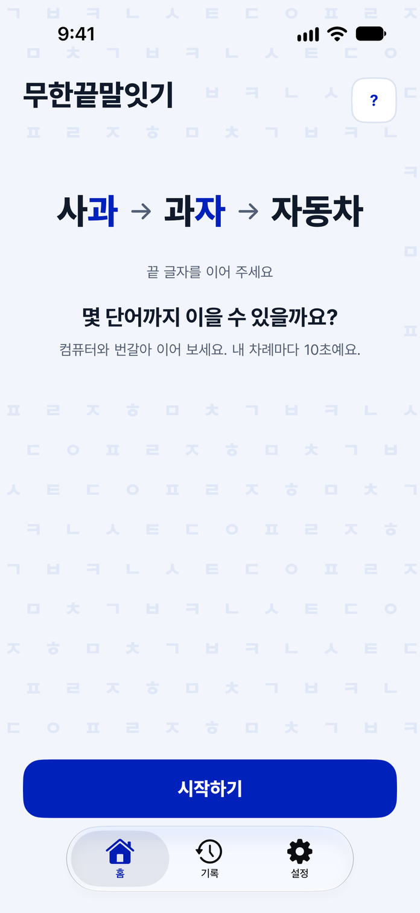
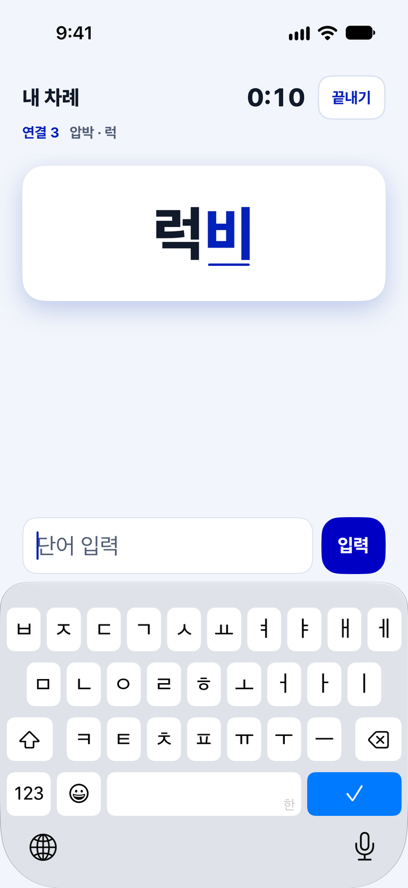
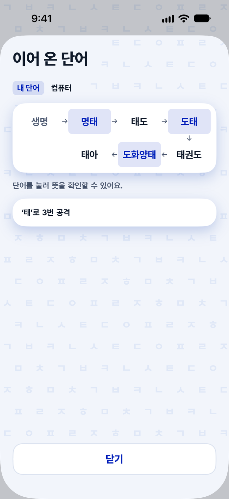

# 무한끝말잇기 · Infinity Word Chain

An offline Korean word-chain game for iPhone. You have ten seconds to reply, and the computer changes the difficulty of its words as you play.

> 앞 단어의 마지막 글자로 시작하는 단어를 10초 안에 입력하세요. 컴퓨터와 번갈아 단어를 잇고, 게임이 끝나면 기록에서 단어의 뜻을 확인할 수 있어요.

[](https://github.com/mhju0/infinity-word-chain/actions/workflows/ci.yml)

<p>
  
  
  
</p>

## How to play

**자동차 → 차표 → 표지**. Start your reply with the last syllable of the previous word. Use a dictionary noun of at least two Korean syllables and avoid words already played in the round. The game also accepts applicable 두음법칙 alternatives, such as **리** or **이** after **다리**.

- Each player turn has ten seconds. You can correct an invalid entry while the clock runs.
- Your score is the total number of words in the chain, including the opening word and the computer's replies.
- Check your past rounds on the device and tap a played word to see its definition when available.

## Run on an iPhone simulator

Use macOS with Xcode 26 or newer, an iPhone simulator running iOS 18 or newer, and XcodeGen (`brew install xcodegen`). The repository includes the dictionary used by the app. Simulator builds require no signing team.

```sh
git clone https://github.com/mhju0/infinity-word-chain.git
cd infinity-word-chain/app
xcodegen generate
open InfinityWordChain.xcodeproj
```

Select the **InfinityWordChain** scheme and an iPhone simulator, then press **⌘R** to run or **⌘U** to run the UI tests.

## Project structure

| Path | Contents |
| --- | --- |
| [app/InfinityWordChain](app/InfinityWordChain) | SwiftUI screens, Korean text input, turn timing, and local match records |
| [app/WordChainKit](app/WordChainKit) | Swift package for Hangul connections, legal moves, scoring, and opponent selection |
| [content](content) | Python dictionary pipeline, bundled data, and dataset validation |
| [app/InfinityWordChainUITests](app/InfinityWordChainUITests) | Simulator flows for gameplay, results, and interruptions |

The dictionary indexes words by their first syllable. The opponent counts unused replies for each possible ending and adjusts its choice using the player's recent turn times and invalid guesses. The clock stays at ten seconds. [Adaptive pacing notes](docs/ADAPTIVE_PACING_FOLLOWUP.md)

### Run the engine and dictionary checks

From the repository root, with Python 3.11 or newer and the Xcode toolchain:

```sh
WORD_CHAIN_CONTENT_DIR="$PWD/content/data" swift test --package-path app/WordChainKit
python3 -m unittest discover -s content/tests -v
```

## Status and credits

This repository contains the development build. The bundled dictionary is a beta snapshot with proper-name and sensitive-homograph review still open. [Dictionary methodology and review status](content/README.md)

The dictionary uses data from the National Institute of Korean Language. The [dictionary credits](content/data/DictionaryCredits.txt) cover the source data and attribution. The app uses [Pretendard](app/InfinityWordChain/Fonts/OFL.txt) for its interface.

For a gameplay, dictionary, or build problem, [open an issue](https://github.com/mhju0/infinity-word-chain/issues/new/choose).
